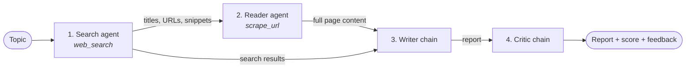

# Multi-Agent Research Assistant

Type a topic and a team of four AI agents researches it for you. They search the web, read the best source in full, write a structured report and then critique that report with a score out of 10.

Built with **LangChain**, **LangGraph** (`create_agent`), **Groq** (`openai/gpt-oss-120b`), **Tavily** web search and a **Streamlit** UI.

---

## How it works



| Step | Component | What it does |
|------|-----------|--------------|
| 1 | **Search agent** | A tool-calling agent that uses Tavily to find recent, reliable sources. Returns titles, URLs and 300-character snippets for the top 5 results. |
| 2 | **Reader agent** | Looks at the search results, picks the most relevant URL and scrapes it. Scripts, styles, navigation and footers are stripped so only readable text is kept (up to 3,000 characters). |
| 3 | **Writer chain** | A prompt → LLM → string chain that combines the search results and scraped content into a report with an **Introduction**, **Key Findings** (at least 3), **Conclusion** and **Sources**. |
| 4 | **Critic chain** | Reviews the report and returns a **Score /10**, **Strengths**, **Areas to Improve** and a one-line verdict. |

Steps 1 and 2 are *agents*: the model decides when and how to call its tool. Steps 3 and 4 are fixed *chains*: one prompt in, one answer out.

## Features

- **Streamlit web UI** with live step-by-step progress
- Results in tabs: **Report**, **Critic feedback**, **Search results** and **Scraped content**
- Critic score shown at the top of the results
- **Download the report** as a Markdown file
- **Command-line mode** that prints every step to the terminal
- Scraping errors are returned to the agent as text, so one bad URL doesn't crash the run

## Tech stack

| Purpose | Library |
|---------|---------|
| LLM | [Groq](https://groq.com) via `langchain-groq`, model `openai/gpt-oss-120b` |
| Agents | `langchain` `create_agent` (built on LangGraph) |
| Chains & prompts | `langchain-core` (`ChatPromptTemplate`, `StrOutputParser`) |
| Web search | [Tavily](https://tavily.com) via `tavily-python` |
| Scraping | `requests` + `beautifulsoup4` |
| UI | `streamlit` |
| Config | `python-dotenv` |
| Packaging | [`uv`](https://docs.astral.sh/uv/) |

## Project structure

```
multi-agent-research/
├── src/multi_agent_research/
│   ├── tools.py      # web_search (Tavily) and scrape_url (requests + BeautifulSoup) tools
│   ├── agents.py     # Groq LLM, search & reader agents, writer & critic chains
│   ├── pipeline.py   # run_research_pipeline(): runs the 4 steps in order (also a CLI)
│   └── app.py        # Streamlit UI
├── .env.example      # template for API keys
├── pyproject.toml    # project metadata and dependencies (uv)
├── uv.lock           # exact locked versions
└── requirements.txt  # for installing with pip
```

## Getting started

### 1. Prerequisites

- **Python 3.14+**
- A free **Groq API key**: <https://console.groq.com/keys>
- A free **Tavily API key**: <https://app.tavily.com>

### 2. Clone the repo

```bash
git clone https://github.com/GuninderSinghBhatia/multi-agent-research.git
cd multi-agent-research
```

### 3. Install dependencies

With **uv** (recommended, uses the exact locked versions):

```bash
uv sync
```

Or with **pip**:

```bash
python -m venv .venv
# Windows: .venv\Scripts\activate    macOS/Linux: source .venv/bin/activate
pip install -r requirements.txt
pip install -e .
```

### 4. Add your API keys

Copy the template and fill in your keys:

```bash
cp .env.example .env
```

```env
GROQ_API_KEY=gsk_...
TAVILY_API_KEY=tvly-...
```

| Variable | Required | Purpose |
|----------|----------|---------|
| `GROQ_API_KEY` | Yes | Runs the LLM for all four steps |
| `TAVILY_API_KEY` | Yes | Web search for the search agent |
| `LANGSMITH_TRACING`, `LANGSMITH_API_KEY`, `LANGSMITH_PROJECT` | No | Trace every agent and chain call in [LangSmith](https://smith.langchain.com) |
| `GOOGLE_API_KEY` | No | Not used yet; reserved for a Gemini model option |

`.env` is listed in `.gitignore`, so your keys are never committed.

## Usage

### Web UI

```bash
uv run streamlit run src/multi_agent_research/app.py
```

Open <http://localhost:8501>, enter a topic (for example *"Latest advances in solid-state batteries"*) and click **Run research**. A full run usually takes about a minute.

> If port 8501 is busy, add `--server.port 8502`.

### Command line

```bash
uv run python -m multi_agent_research.pipeline
```

You'll be asked for a topic, and each step's output is printed as it finishes.

### From your own code

```python
from multi_agent_research.pipeline import run_research_pipeline

result = run_research_pipeline(
    "Latest advances in solid-state batteries",
    on_step=lambda n, label: print(f"Step {n}/4: {label}"),  # optional progress callback
)

print(result["report"])    # final report (Markdown)
print(result["feedback"])  # critic's score and review
# also: result["search_results"], result["scraped_content"]
```

## Customising

| What | Where |
|------|-------|
| Model or temperature | `llm = ChatGroq(...)` in [`agents.py`](src/multi_agent_research/agents.py) |
| Number of search results | `max_results=5` in `web_search`, [`tools.py`](src/multi_agent_research/tools.py) |
| Snippet length / scraped text length | `[:300]` in `web_search` and `[:3000]` in `scrape_url`, [`tools.py`](src/multi_agent_research/tools.py) |
| Report structure | `writer_prompt` in [`agents.py`](src/multi_agent_research/agents.py) |
| Critic format and strictness | `critic_prompt` in [`agents.py`](src/multi_agent_research/agents.py) |

## Limitations

- The reader agent scrapes **one** page, and scraped text is capped at 3,000 characters to keep prompts small.
- Pages that need JavaScript to render, or that block bots, may return little or no text.
- The critic reviews the report but the report is not rewritten afterwards. A revise loop (writer → critic → writer) would be a natural next step.
- Report quality depends on what Tavily finds; always check the listed sources.

## Ideas for next steps

- Let the reader agent scrape several sources instead of one
- Feed the critic's feedback back to the writer for a revision round
- Turn the pipeline into a LangGraph `StateGraph` with conditional edges
- Stream the report into the UI as it's written
- Add a model picker (Groq / Gemini) in the UI
